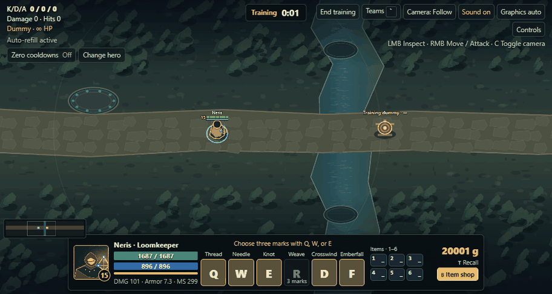
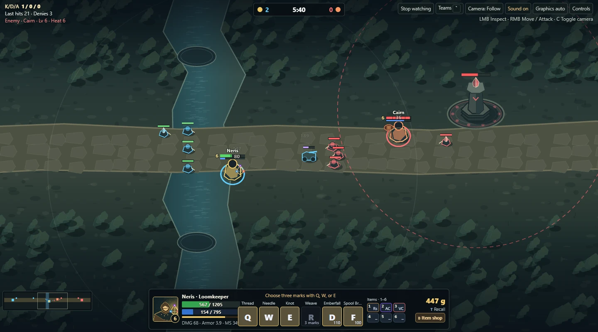

# Lanebreak

**A Dota-inspired browser MOBA with one-lane duels, three-lane 5v5, and an offline practice arena.**

[Play offline](#play-offline) · [Controls](#controls) · [Heroes](#heroes) · [Run a server](#run-a-server)

[](https://github.com/dizhouwu/lanebreak/actions/workflows/build.yml)



**Neris training combo** · Crosswind (`QWW`) → Emberfall (`WEE`) → Spool Break (`QWE`)

## Pick a mode

| Mode | What you play |
| --- | --- |
| **1v1 Duel** | Last-hit and deny creeps, contest river runes, and push through a single lane. Play against a bot or challenge another player online. |
| **5v5 Battlefield** | Fight from opposite corners of a three-lane map. Play with bots or invite friends to a private room. Bots fill open seats. |
| **Training** | Try any hero, test full builds, and practice combos against an unlimited-health dummy or in an empty arena. Switch heroes without leaving. |

Build six-slot loadouts with active items for blinks, cyclones, stuns, and detection. Fortify allied towers, buy back into a fight, and track every player's K/D/A and items with the backtick key. Kill streaks and multikills appear as on-screen banners.



## Play offline

1. Open [lanebreak.html](lanebreak.html) on GitHub and click **Download raw file**.
2. Open the downloaded file in a desktop browser. The standalone game includes the engine, graphics, and audio.
3. Choose a hero, then start **Solo 1v1**, **5v5** with bots, or **Training**.

To jump straight into a mode, add a fragment to the URL. Try `#play=brakk,hard` for a duel, `#teams=cairn` for 5v5, or `#training=neris` for practice. Add `&dummy=off` to train in an empty arena. Use `#demo=brakk,normal,300` to spectate a bot duel starting at the five-minute mark.

## Controls

| Action | Controls |
| --- | --- |
| Move, attack, or deny | Right-click |
| Inspect a unit / select owned units | Left-click / drag a selection box |
| Use an ability / confirm a target / cancel | Ability key / left-click / right-click or Esc |
| Attack the unit under the cursor or attack-move / stop | A / S |
| Use an active item / open the shop / recall | 1–6 / B / T |
| Select your hero / select all owned units | Z or F1 / X or F2 |
| Toggle follow camera / recenter on your hero | C / Space |
| Pan the free camera | Arrow keys, middle-mouse drag, minimap, or screen edges |
| Open the scoreboard while playing | Backtick (<kbd>`</kbd>) |
| Pause a solo game / change graphics / toggle sound | P or Esc / G / M |

The camera follows your hero by default, and 5v5 uses a wider view. Use **Fullscreen** in the match toolbar to move the browser controls away from the play area, or **Z/X** if your browser captures the function keys. Click **End match** to finish a solo game and see your stats. In online 1v1, confirm **Surrender** to award the win to your opponent.

## Heroes

Hover over a hero on the home screen for a kit preview, or open **Abilities & builds** to see abilities and two recommended six-item loadouts. **Item guide** lets you search by name, effect, or recipe component.

| Hero | Play style |
| --- | --- |
| **Vesper**, Tide Archer | Ranged pressure with piercing arrows and snares |
| **Brakk**, Iron Ram | Durable melee brawler with a charge and lifesteal |
| **Orrin**, Gravity Sage | Burst caster with delayed impacts and a blink |
| **Kestrel**, Arc Runner | Lightning skirmisher with a short reel, charged splash attacks, and a cooldown-free dash priced by distance and maximum mana |
| **Veyra**, Cinder Pilgrim | Fire skirmisher who dashes through up to three planted brands |
| **Morrow**, Chain Warden | Chain initiator who can pull in an enemy or rescue an ally |
| **Calyx**, Glassknife | Blink assassin with a tracking dagger and a critical strike every fourth hit on the same hero |
| **Neris**, Loomkeeper | Spell weaver with ten recipes and two prepared spell slots |
| **Cairn**, Kiln Keeper | Facing-based burst carry who builds Heat by last-hitting creeps |
| **Ecarg**, String Virtuoso | Violinist who marks targets for stronger follow-up spells |

<details>
<summary><strong>Neris's spell recipes and combos</strong></summary>

Neris queues marks with **Q** (Thread), **W** (Needle), and **E** (Knot). Only the latest three count, in any order. **R** prepares a new recipe in **D**, moves the previous spell to **F**, and starts a 0.5-second base cooldown. Re-invoking a prepared recipe brings it to **D** immediately and preserves the current **R** timer. Each spell keeps its own cooldown when it changes slots or is prepared again.

| Marks | Spell |
| --- | --- |
| QQQ | **Pin Stitch** locks onto an enemy hero and marks them for follow-up staggers. |
| QQW | **Veil Stitch** grants temporary invisibility that ends when you attack or cast. |
| QQE | **Frost Loom** places an ice wall just ahead of you, perpendicular to your facing. |
| QWW | **Crosswind** sends a click-aimed tornado that damages and lifts enemies. |
| QWE | **Spool Break** knocks enemies back along the shockwave's path and disarms heroes. |
| QEE | **Fire Spirits** summons two units you can select and command. |
| WWW | **Hollow Seam** drains mana after a delay. |
| WWE | **Tighten Thread** grants temporary attack speed and attack damage. |
| WEE | **Emberfall** drops a rolling meteor that burns enemies in its path. |
| EEE | **Sky Needle** strikes a distant target area after a delay. |

Prepare **QWW** and **WWW** before a fight. Lift the target with Crosswind and time Hollow Seam to burst as they land. Follow with **WEE** and aim **QWE** to knock the target along the meteor's path for repeat hits.

For a Galeglass combo, prepare **EEE** in F and **WEE** in D. Lift the target with Galeglass, then cast Sky Needle from F with about one second left. Prepare **QWE**, cast Emberfall from F with about half a second left, and time Spool Break from D to arrive after the meteor lands.

</details>

<details>
<summary><strong>Veyra, Cairn, and Ecarg mechanics</strong></summary>

- **Veyra** plants up to three fire brands with **R**. Press **D** and click the ground to detonate them all, ending at the brand nearest the click.
- **Cairn** centers **Q**, **W**, and **E** at 200, 450, and 700 units along his facing. Each blast has a 180-unit radius, so adjacent blasts can hit the same target. Turn with a move or attack order first. Enemy creep last hits grant up to six Heat for 3 attack damage each. Death removes half the stored Heat, and **R** spends all of it to strengthen his channeled blast.
- **Ecarg** marks enemy heroes with **Downbow**. **Overtone** and **Grand Cadence** consume that mark for extra damage and a short stun. **Countertempo** boosts movement and attack speed.

</details>

## Match and training details

<details>
<summary><strong>Lane objectives, shop, and combat</strong></summary>

- **Creeps and runes.** Attack an enemy hero near their creeps to draw aggro. Right-click or press **A** over an allied creep to redirect creeps attacking you. Allied creeps can be denied when their health bars turn purple. The hero who collects an Insight rune gains 220 XP.
- **5v5 map.** Azure starts in the southwest and Crimson in the northeast. Destroy the outer and inner towers in any one lane to expose the enemy core. Enemy fountains fire high-damage beams at intruders.
- **Fortify and buyback.** Fortification protects allied towers for five seconds and lets each tower fire at up to five creeps per volley. The 180-second cooldown is shared by the team. Buyback costs 200 gold plus 50 per hero level and has a 240-second cooldown per hero.
- **Shop recipes.** Click an item to see its components. The shop deducts the value of parts you already own. **Recommended builds** links each loadout to its recipes, and **Builds into** shows possible upgrades. Click an inventory item to sell it at the fountain.
- **Active items.** Use **Rift Stone** to blink toward a clicked point, **Galeglass** to lift a target, **Faultline Maul** to stun, and **Revelation Dust** to reveal invisible enemies.
- **Late-game equipment.** **Hushthorn** silences an enemy hero and deals follow-up damage when the seal expires. **Sovereign Aegis** clears dispellable debuffs and grants brief debuff immunity and spell damage reduction. **Dreadforged Edge** and **Astral Crucible** upgrade attack and spell builds.
- **Progression.** Heroes can reach level 20. Fountain regeneration lingers for one second after leaving, and tower attack range exceeds every hero's basic attack range.

</details>

<details>
<summary><strong>Training settings</strong></summary>

Training starts at level 15 with gold for testing builds. Abilities cost no mana and resources refill automatically. **Zero cooldowns** starts on. Turn it off to practice normal ability, item, and recall timings, and use **Renewal Orb** to refresh abilities and other item actives. The dummy stays put unless moved by an ability, and the damage counter tracks your session total.

**Change hero** keeps your location, items, and session totals. Active abilities, summons, and temporary statuses clear when you switch.

</details>

## Run a server

Install Node.js 22 or newer and stable Rust through [rustup](https://rustup.rs/). Use the Visual Studio C++ build tools on Windows, Xcode Command Line Tools on macOS, or your distribution's C compiler and build tools on Linux.

```sh
git clone https://github.com/dizhouwu/lanebreak.git
cd lanebreak
rustup target add wasm32-unknown-unknown
npm run build
npm start
```

Open [localhost:8377](http://127.0.0.1:8377/). In **Online 1v1**, host and share a room link or code, or use **Find opponent**. For a private **5v5** match, pick a team or let the lobby balance the sides. The host can start at any time, with bots filling the remaining seats.

The build bundles WebAssembly into the standalone HTML and compiles a native add-on for the server. Build on the destination operating system when moving to another machine. Windows users can also double-click `Start-Lanebreak.cmd` after installing the prerequisites.

<details>
<summary><strong>LAN play and Cloudflare Tunnel</strong></summary>

For LAN play, run `node lanebreak_server.js --host=0.0.0.0` and open the host's LAN address on port 8377 from a second device.

For Cloudflare Tunnel, run `npm start` and `cloudflared` on the same host. Point the public hostname to `http://127.0.0.1:8377` in **Published application** settings. Keep the default loopback listener and preserve the public Host header through the tunnel. The HTTPS page connects to `/ws` on the same hostname.

Check `/healthz`, then use two devices to host, join, and reconnect after a refresh. The tab's seat token enables reconnects. A bot takes over while a player is disconnected. Restarting the server clears active rooms.

- [Cloudflare Tunnel setup](https://developers.cloudflare.com/tunnel/get-started/)
- [Cloudflare WebSockets](https://developers.cloudflare.com/network/websockets/)

</details>

## How it works

| Layer | Implementation |
| --- | --- |
| **Match simulation** | [Rust engine](rust/engine) runs movement, combat, abilities, items, objectives, and rule-based bots. [Rust physics](rust/physics) handles collision and projectile queries. |
| **Browser** | WebAssembly runs solo and training matches. JavaScript handles input and presentation. WebGL 2 batches units, health bars, and basic-attack projectiles. Canvas 2D draws terrain and spell effects and provides a fallback. |
| **Online** | Node.js loads the same engine through [native bindings](rust/node), simulates at 60 Hz, and sends snapshots over WebSockets at roughly 30 Hz. |
| **Balance** | Heroes, items, and bot difficulty share one [rules table](src/rules.json). |

The cross-platform workflow builds and tests on Windows, Linux, Apple Silicon, and Intel macOS. After changing source or rules, rebuild and restart the server.

```sh
npm test         # Engine and network tests
npm run balance  # Bot matchups and match length
```

[Apache-2.0 license](LICENSE)
